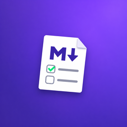
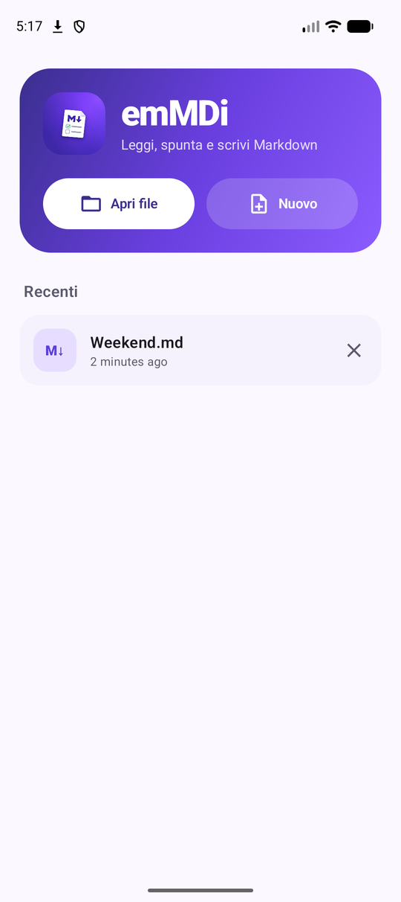
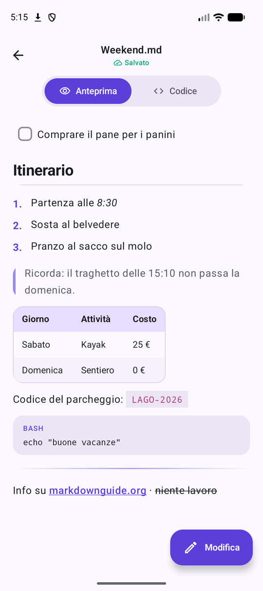
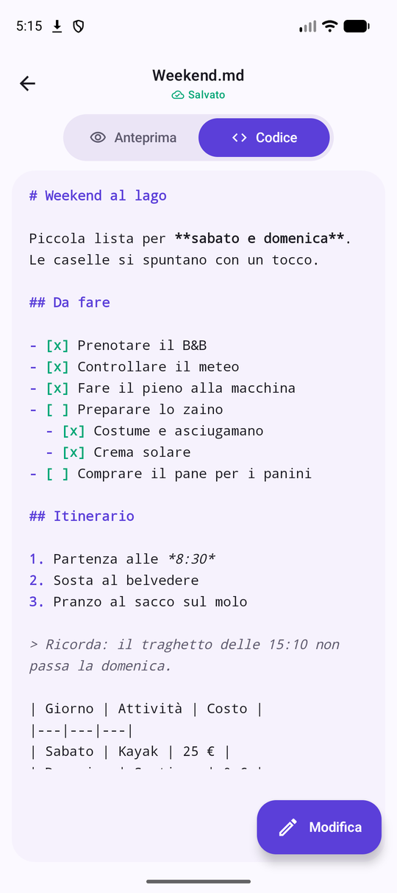
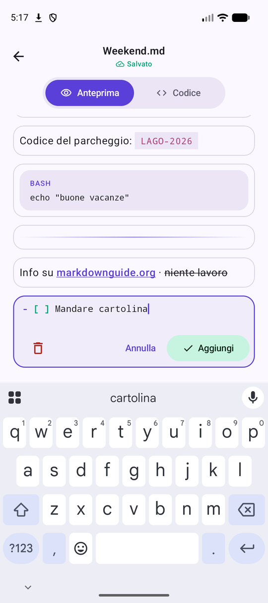

<p align="center">
  
</p>

<h1 align="center">emMDi</h1>

<p align="center">
  Un lettore di file Markdown per Android, semplice e curato.<br>
  Leggi, spunta le to-do e, quando serve, modifica: dal codice o direttamente dall'anteprima.
</p>

<p align="center">
  <a href="../../releases/latest"><b>⬇ Scarica l'APK</b></a>
</p>

<p align="center">
  
  
  
</p>
<p align="center">
  
  
  
</p>

## Cosa fa

- **Due viste**: *Anteprima* (Markdown formattato) e *Codice* (sorgente con evidenziazione della sintassi), con passaggio animato.
- **To-do interattive**: tocca una casella `- [ ]` per spuntarla o togliere la spunta. Il file viene salvato subito. Funziona anche con liste annidate e dentro le citazioni.
- **Modifica dal codice**: tocca *Modifica* nella vista Codice e scrivi direttamente nel sorgente.
- **Modifica dall'anteprima**: in modalità *Modifica* tocca un blocco (titolo, paragrafo, lista, tabella…) per modificarlo sul posto, eliminarlo, oppure aggiungi nuovi blocchi (to-do, testo, titolo, elenco, citazione, codice).
- **Salvataggio automatico** sul file originale, con indicatore di stato.
- **File recenti**, apertura da qualsiasi file manager (*Apri con → emMDi*) e creazione di nuovi file `.md`.
- Supporto a titoli, grassetto, corsivo, barrato, link, codice in linea e a blocchi, citazioni, liste numerate, tabelle e linee di separazione.
- Tema chiaro e scuro, icona tematizzata su Android 13+.

## Installazione

Scarica `emMDi-x.y.z.apk` dalla [pagina delle release](../../releases/latest) e aprilo sul telefono (Android 8.0 o superiore). Potrebbe essere necessario consentire l'installazione da origini sconosciute.

## Compilare

Serve JDK 17+ e l'Android SDK (API 36).

```bash
./gradlew assembleRelease
```

Per firmare con una chiave propria, crea `keystore.properties` nella radice del progetto (è escluso da git):

```properties
storeFile=/percorso/della/chiave.jks
storePassword=...
keyAlias=...
keyPassword=...
```

Senza quel file l'APK di release viene firmato con la chiave di debug.

## Tecnologie

Kotlin, Jetpack Compose, Material 3 e [commonmark-java](https://github.com/commonmark/commonmark-java) con le estensioni GFM (tabelle, barrato, task list).
